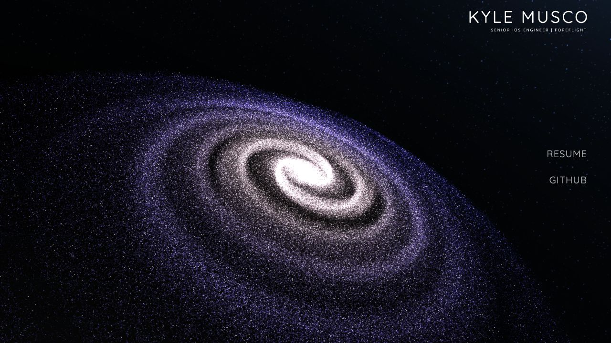

# Before-refactor baseline

Captured September 25, 2026, from commit `3d9ad55` on branch `v2`.
Step 1 adds documentation and a local measurement page only. Existing site files
are unchanged. The `2019` directory was excluded from inspection and inventory.

## Content and URLs to preserve

| Item | Existing value or public path | Refactor requirement |
| --- | --- | --- |
| Name | KYLE MUSCO | Retain as the primary heading |
| Subtitle | SENIOR IOS ENGINEER \| FOREFLIGHT | Retain unless the owner requests a content change |
| Homepage | `/`, `/index.html` | Keep the same entry point |
| Résumé | `/Kyle%20Musco%20-%20Resume.pdf` | Keep the PDF and URL working |
| GitHub | `https://github.com/kylemusco` | Preserve the destination |
| Favicon | `/images/space_icon.png` | Preserve the public path during migration |
| Social preview | `/images/metaimage.png` | Preserve the public path; refresh metadata separately |
| Background texture | `/images/space.png` | Retain the original asset during migration |
| 2022 archive | `/2022/`, `/2022/index.html`, `/2022/projects.html` | Keep separate from the new homepage |
| Archive résumé | `/2022/Kyle%20Musco%20-%20Resume.pdf` | Preserve this distinct archived file |
| Existing assets | `css/`, `js/`, `images/` | Stop loading obsolete code on the homepage when replaced; avoid silently removing public URLs |

The source manifest records paths, byte sizes, and SHA-256 hashes for all 67
tracked files outside `2019` (6,554,462 bytes total). It includes the two distinct
résumé PDFs and the `2022` archive. This is an inventory, not a homepage download
size. Git retains the original source snapshot.

`url-checks.json` records 19 successful HTTP 200 checks against the local preview:
the homepage, its referenced local resources, the background/social images, and
the primary archive entry points. External URLs were inventoried, not changed;
the production host was not audited. The archive's other tracked files are
covered by the manifest.

## Visual baseline

Desktop, 1280 × 720 CSS pixels:



Narrow viewport, 390 × 844 CSS pixels:


After resizing the same narrow page to 844 × 390 without reloading:


The narrow capture uses a desktop user agent. It is not iPhone/Android emulation
or a physical-device result. The site's user-agent-based mobile branch is not
activated by resizing, so this run still renders one million stars.

## Performance sample

| Measurement | Desktop 1280 × 720 | Narrow 390 × 844 |
| --- | ---: | ---: |
| Device pixel ratio reported by browser | 2 | 1 |
| DOM content loaded | 241.3 ms | 213.9 ms |
| Load event completed | 241.5 ms | 214.0 ms |
| First contentful paint | 276 ms | 244 ms |
| Mean animation callback cadence | 120.0 FPS | 119.9 FPS |
| Median / p95 frame interval | 8.3 / 9.3 ms | 8.3 / 9.3 ms |
| Sample intervals over 50 ms | 0 | 0 |
| Approximate used JS heap | 431.7 MiB | 432.6 MiB |
| Stars / velocity objects / acceleration objects | 1M / 1M / 1M | 1M / 1M / 1M |
| Canvas count | 2 | 2 |

Raw results are in `desktop-metrics.json` and `narrow-metrics.json`. Both runs use
the Codex in-app Chromium browser (reported Chrome 153) on the local Mac, no
CPU/network throttling, interaction disabled, and a visible document. Each run
waits two seconds after load and samples requestAnimationFrame timestamps for
five seconds. Cache was not cleared. These are single local samples, not cold
production-load benchmarks, GPU timings, or mobile performance claims.

The report comes from the unchanged page loaded in a same-origin iframe.
`performance.memory` is approximate, can include shared contexts/the parent,
and excludes GPU allocations. Do not interpret it as isolated galaxy memory.
Navigation/paint timings do not establish the exact time the galaxy becomes
fully visible. Repeated, controlled measurements are needed before claiming
performance improvements. Match browser, viewport, DPR, and cache conditions.

## Confirmed issues and follow-up

- Two independently scheduled WebGL renderers, Three.js r77, legacy Geometry,
  and millions of per-star objects. Replace in steps 4–5.
- At 390 × 844, links overlap the bright galaxy core and become hard to read.
  Protect text contrast and adjust composition in steps 3 and 7.
- Resizing to 844 × 390 leaves both canvas buffers at 390 × 844. Handle renderer
  size and camera aspect changes in steps 5 and 7.
- No viewport meta tag, no semantic heading/nav, fixed desktop positioning,
  device-name detection, and a global 200px body padding rule. Address in step 3.
- Always-running loops and no reduced-motion/static fallback path. Address in
  step 7; physical iOS/Android, reduced-motion, and graphics-failure checks remain
  for step 9.
- Console reports the legacy ImageUtils.loadTexture deprecation. Replace in
  step 5. One source-less MutationObserver error appeared during tooling
  navigation; its origin is unconfirmed and it is not attributed to the website.
- The hidden interaction attracts/removes stars and changes camera motion.
  Preserve the requested repulsion behavior as a separate future feature.
- The original galaxy credits Astrak's CodePen. Preserve provenance notices
  for any reused code/assets during replacement.
- The two résumé PDFs are separate artifacts. Do not replace the archive's PDF
  with the homepage PDF as part of asset reorganization.

## Reproduce

From the project root:

```sh
python3 -m http.server 4173 --bind 127.0.0.1
```

Open `http://127.0.0.1:4173/` for screenshots. Set the viewport **before** reloading
to capture the initial layout; resize without reload to reproduce the defect.
Open `http://127.0.0.1:4173/docs/baseline/measure.html` for a measurement. Keep it
visible until the result expands, then copy the JSON. The helper makes no writes
or external telemetry requests; the homepage still loads its existing CDN
dependencies. Do not ship the helper in the future Vite production output.

The current helper reads a few legacy globals for star counts. Adapt that
diagnostic portion when the renderer is replaced, keeping timing methodology
consistent. Use real mobile devices for the final browser/performance matrix.
