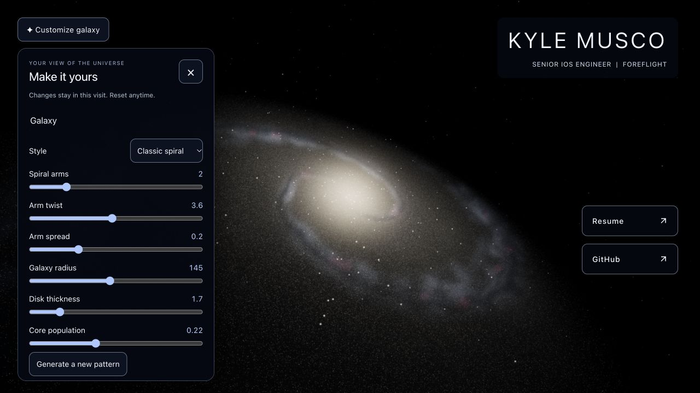

# Interactive galaxy — customization, camera, and desktop repulsion

Completed September 30, 2026 on Node 24.21.0 / npm 11.19.0. No deployment,
remote push, dependency upgrade, or excluded archive change.

## Accomplished

- Added a collapsible, scrollable customization panel with named keyboard controls,
  presets, shape sliders, random seeds, and device-budget-relative star detail.
- Added orbit, elevation, distance, roll, field of view, and XYZ target panning.
  Camera changes apply immediately without rebuilding stars. Camera reset restores
  position `[-100, -100, 80]`, target `[0, 0, 0]`, roll `-0.7`, and FOV `70`.
- Added opt-in desktop mouse repulsion. Eight bounded shader impulses move nearby
  stars outward and ease back to their immutable rest positions. Dust, gas and
  background stars stay in place. No second animation loop or per-star CPU
  simulation buffers are introduced.
- Added status subscriptions, graphics availability feedback, debounced worker
  updates, and reset that clears pending edits and disables interaction.
- Kept static profile rendering separate from client-only controls and graphics.
  The approved camera/default galaxy, animation, adaptive budgets, fallback,
  reduced-motion behavior, original links and assets remain intact.

## Validation

`npm run check`: TypeScript, ESLint, **31 tests**, and formatting passed.
`npm run build`: production build, **66 preserved asset hashes**, and **72 file
checks** passed. No production fixture files are emitted. The existing large
Three.js chunk warning and upstream `THREE.Clock` deprecation remain.
[HTTP evidence](interactive-http-checks.json) verifies the same production build
served on localhost:4174, including original assets, worker and `/2022/`.

The isolated in-app Chromium browser exercised the actual application, then the
compiled production page. The development fixture exposes renderer observations
in the DOM; no production diagnostic interface is added.

| Check                    | Observed result                                                                                                     |
| ------------------------ | ------------------------------------------------------------------------------------------------------------------- |
| Presets / detail         | Four-arm and open-spiral selections complete generation; Light detail and full reset work in production             |
| Camera                   | Orbit, target pan, FOV and elevation update live; reset restores exact default position/quaternion/FOV              |
| Pending slider reset     | Default shape remains selected after reset; repulsion becomes unchecked                                             |
| Desktop repulsion        | Real mouse input raised the shader active flag to 1; it returned to 0 after settling; rest buffer identity retained |
| Resources                | One canvas, one frame subscriber, 4 geometries and 14 textures before/after interaction                             |
| Touch capability fixture | Balanced initial budget of 400,000; camera works; repulsion disabled                                                |
| Reduced-motion fixture   | Demand rendering, zero rotation, repulsion disabled; explicit camera update renders                                 |
| Worker denial            | Error/retry guidance with usable static backdrop, name, résumé and GitHub links                                     |
| 390×844 / 320×568        | Scrollable controls and reset reachable; 320 px document has no horizontal overflow                                 |
| Keyboard                 | Named sliders respond to arrows; Escape closes panel and returns focus to trigger                                   |
| Production runtime       | No errors from the production page; earlier development errors were fixed before the build                          |

Desktop repulsion is a visual effect, not a gravitational simulation. Projection
uses the galaxy disk plane and rejects near-parallel rays rather than creating
unstable distant impulses. Settings are intentionally visit-local.

- [Camera and interaction controls](interactive-camera.png)
- [Mobile controls](interactive-mobile.png)

## Remaining validation

Physical iOS/Android and native Safari/Firefox/Edge checks remain open in the
[release checklist](../release-checklist.md). Viewport resizing and overridden
capability queries do not substitute for real touch, safe areas, accessibility
preferences, or sustained thermal/GPU measurements. Sustained mouse-repulsion
performance on lower-end desktop GPUs also needs device testing; the existing
adaptive quality monitor remains enabled. No new performance threshold is claimed.

Possible later additions, outside this request: shareable/saved configurations
and direct drag/orbit gestures. The implemented sliders provide camera control
on both desktop and mobile without interfering with existing touch navigation.
