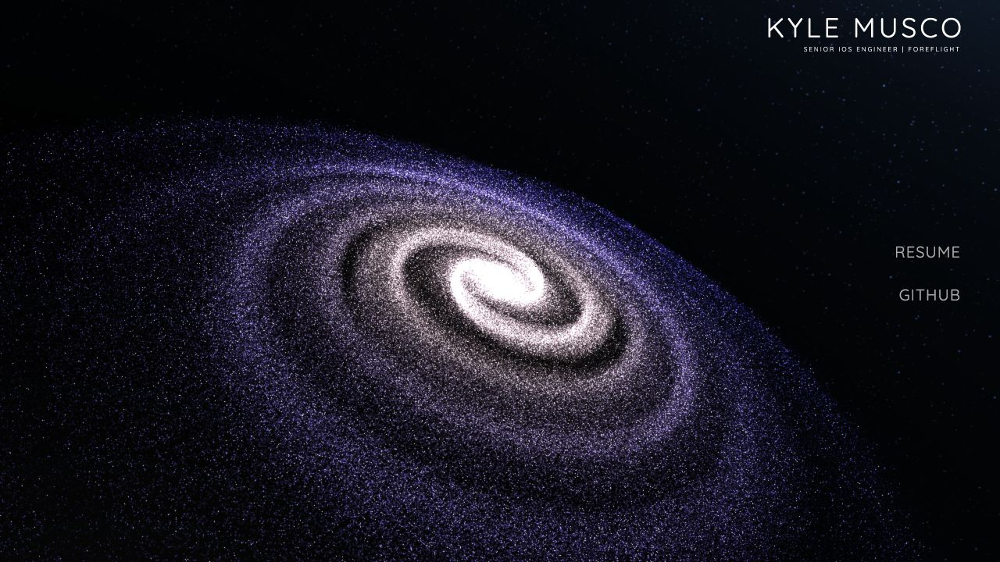
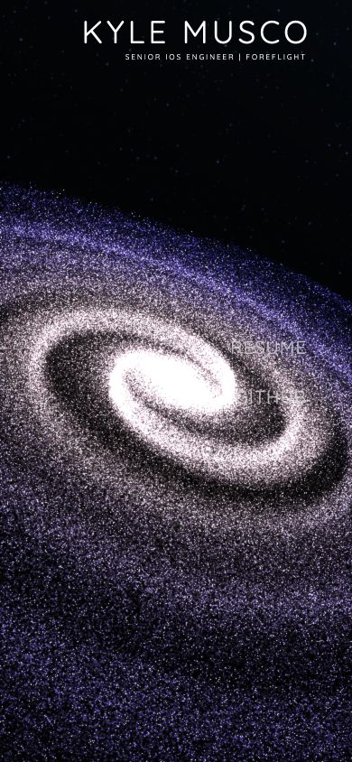

# Step 2 — Modern project foundation

## Completed

- Added React 19.3, Vite 8.3, strict TypeScript 6.0, and compatible modern
  Three.js 0.186 / React Three Fiber 9.8 dependencies with an npm lockfile.
- Added Node 24 selection, engine enforcement, editor conventions, typed ESLint,
  React Hooks/Refresh rules, Prettier, and documented development/build commands.
- Introduced a StrictMode React entry owning the résumé and GitHub navigation.
  Corrected link/list nesting and retained a no-JavaScript link fallback.
- Moved 66 existing static files into `public/` without changing their bytes or
  public URLs. Kept the `2022` archive and its résumé separate. Left `2019`
  untouched and excluded from linting, formatting, and the production build.
- Added build verification against the baseline checksums, and root README
  instructions for using Vite locally and deploying static `dist/` output.

## Verification

- Dependency installation completed with zero vulnerabilities reported by npm
  for the installed package graph. This does not audit the legacy vendored code.
- The lockfile was validated with a clean `npm ci` installation.
- `npm run check`: strict typecheck, typed ESLint, and Prettier passed.
- `npm run build`: Vite production compilation and all 66 static asset checksum
  comparisons passed.
- `npm ls --depth=0`: direct dependencies resolve without peer errors.
- All 19 baseline URLs returned HTTP 200 from the production preview. Static
  response bodies matched baseline hashes; the root returned the compiled app.
  See [URL results](step-2-url-checks.json).
- Browser smoke checks passed for development and production in the in-app
  Chromium browser. The galaxy remained visible, React navigation mounted,
  and keyboard Tab moved from Resume to Github. Checked the production page
  at 1280 × 720 and 390 × 844; these remain desktop-browser viewport checks.
- The only source-attributed browser warning was the existing Three.js texture
  loader deprecation, scheduled for replacement in step 5.

## Remaining and newly discovered items

- Step 3 is next: responsive, accessible page shell and metadata. The original
  mobile overlap, resizing defect, and legacy animations remain scheduled work.
- The active shell initially had Node 22.5.1, below current Vite's requirement.
  Validation used the available Node 24.19.0 runtime. Install/use Node 24 through
  nvm using the commands in the root README; no system default was changed by
  this checkpoint.
- Current typescript-eslint supports TypeScript below 6.1, so TypeScript 6.0.3
  was selected instead of the incompatible latest TypeScript 7.
- Modern Three.js/R3F are installed but intentionally not imported yet. The
  galaxy still uses preserved Three.js r77 and jQuery until steps 3–5.
- The legacy character animation treats formatting whitespace as characters.
  The heading text nodes are kept verbatim until step 3 replaces that animation;
  this prevents a wrapping regression found during the narrow-screen check.
- Source `index.html` now requires Vite; Apache should serve the built `dist/`
  output. Preserve any separately hosted `/2019/` content when deploying, since
  it is out of scope and absent from `dist/`.
- No deployment, remote push, or step 3 work is included in this checkpoint.
