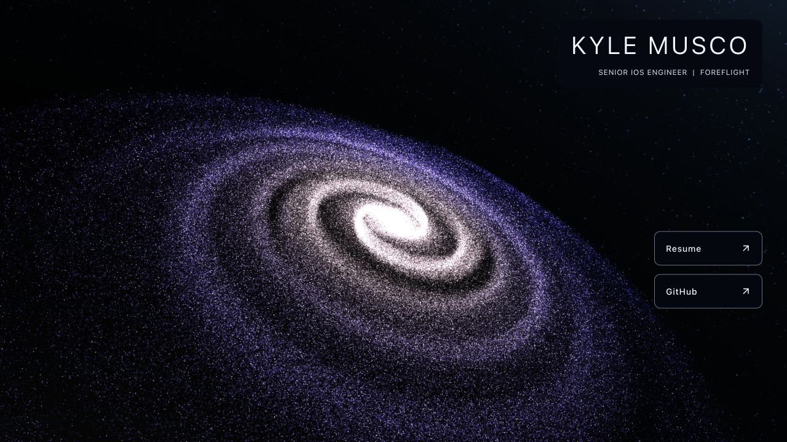
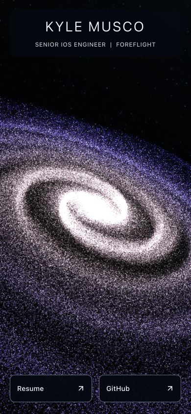
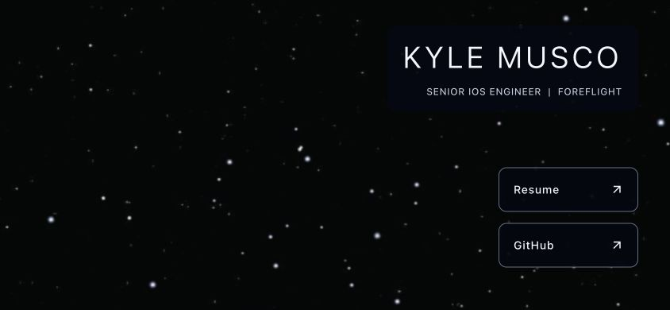

# Step 3 — Responsive, accessible profile shell

## Completed

- Replaced the legacy profile markup and page CSS with a React shell containing
  one `main`, one `h1`, the current role, and labeled profile navigation.
- Added responsive typography, dark panels with predictable text contrast,
  56px-minimum link targets, visible keyboard focus, and accessible descriptions
  for the résumé PDF and links opening new tabs.
- Positioned links near the bottom on phones and to the right on desktop. Added
  safe-area spacing and dynamic viewport height support without disabling page
  scrolling or browser zoom. At the narrowest widths links stack vertically.
- Pre-rendered the same React component into development and production HTML
  using Vite's HTML transform hook, then hydrated it on the client. Essential
  content is present before application scripts run; a static starfield remains
  if graphics do not initialize. No production Node server is required.
- Hid the decorative backdrop from assistive technology and pointer hit testing.
  Removed the legacy heading animation and font request from the active page.
  The shell uses system fonts and disables link transitions for reduced motion.
- Stopped loading old portfolio resources, navigation, animation libraries, and
  page styles. Preserved their original public files/URLs unchanged.
- Added language and viewport declarations, page description, HTTPS canonical
  and Open Graph URLs, website metadata, image description, and a large-image
  social card. Preserved the résumé/GitHub destinations and both archive files.

## Verification

- Node 24.21.0/npm 11.19.0: typecheck, typed linting, formatting, production build,
  and all 66 preserved asset checksum comparisons passed.
- All 19 baseline URLs returned HTTP 200 from the production preview. Static
  response bodies matched their original hashes. See
  [URL checks](step-3-url-checks.json).
- Both dev and production HTTP responses include the complete profile HTML,
  a single main/heading, and both links without executing JavaScript. Browser
  checks showed the hydrated shell with no runtime/hydration errors; the
  existing Three.js texture-loader deprecation warning remains.
- Layout checks at 1280 × 720, 390 × 844, 320 × 568, and 844 × 390 showed no
  horizontal overflow, no header/link overlap, and 56px-high links. The landscape
  check resized an existing page without reload. See
  [layout measurements](step-3-layout-checks.json).
- Keyboard Tab moved from the résumé to GitHub, showing a 3px focus outline.
- A temporary copy of the production HTML with **all script tags removed**
  retained the complete profile and links over the static starfield. This is a
  script-free fixture check, not a browser JavaScript-setting emulation.
- A second script-free fixture with a 200% root font size, at 320 × 568, kept
  all content within the page width. It grew vertically to allow scrolling;
  keyboard navigation brought the lower link into view. This tests text-size
  reflow, not a physical device or browser zoom setting.
- Calculated text contrast over a worst-case pure-white galaxy pixel: heading
  15.95:1, subtitle 10.79:1, links 16.76:1, using the panels' declared opacity.
  These are targeted checks, not a complete accessibility certification.

## Remaining and newly discovered items

- Steps 4–9 remain. Next: typed galaxy configuration, seeded generation, and
  separation of rendering/camera/control responsibilities.
- The shell reflows on resize, but the old renderers still do not update camera
  projection or their buffer sizes. CSS stretches the canvas to fill the screen
  for now; correct 3D framing belongs to steps 5 and 7.
- Reduced-motion handling for the galaxy, hidden-tab pause, adaptive quality,
  and graphics context recovery remain renderer work in steps 5 and 7.
- The legacy renderer still needs external jQuery. Essential profile content no
  longer depends on it; remove that dependency with the rendering replacement.
- The preserved social-preview image includes old profile text. Create a fresh
  preview after the new galaxy is visually settled, while retaining the old
  image URL as an archived asset.
- Physical iOS/Android and the full desktop browser/accessibility matrix remain
  for step 9. These checks used the in-app Chromium browser on the local Mac.
- The `2019` directory remains untouched. No deployment or remote push occurred.

Temporary script-free/text-size fixture files were used only for verification
and are excluded from the final production output.
