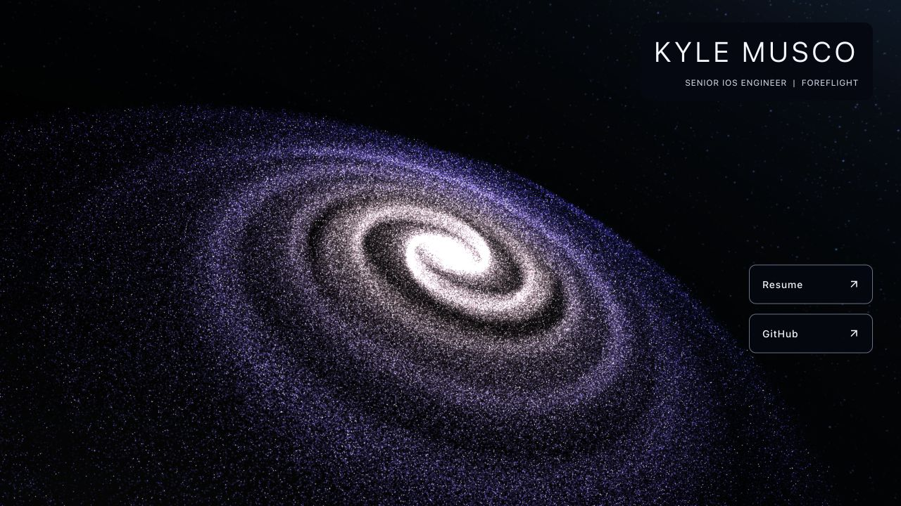
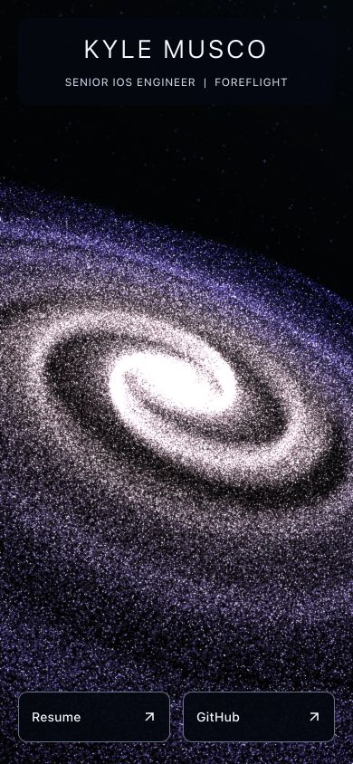

# Step 4 — Separate galaxy generation, rendering, and controls

## Completed

- Extracted typed galaxy and camera settings, seeded random generation, camera
  pose application, frame scheduling, and client startup into `src/galaxy/`.
  The active homepage uses these modules, not the original galaxy/space scripts.
- Kept generation independent of React, Three.js, the DOM, and device detection.
  It returns interleaved XYZ `Float32Array` positions; repeated seeds/settings
  reproduce positions, and lower star counts preserve the sequence prefix.
  Each result owns its buffer and random stream. Numerical bounds are checked
  before allocation, with finite positions at the center and for circular axes.
- Preserved the existing ellipse distribution and Astrak attribution. The new
  seed fixes the otherwise-random arrangement; realism is still step 6.
- Isolated the r77 API behind a temporary typed adapter. Galaxy shape, camera
  pose, render resources, and loop ownership now have separate responsibilities.
  Per-frame work does not update React state. Camera pose application does not
  invoke generation or require access to a global scene.
- Removed jQuery and the old galaxy/space scripts from the homepage. This also
  removes dormant attraction/portfolio code, mouse listeners, global scene and
  camera variables, and the `String.prototype.replaceAll` override from execution.
  All original public files remain byte-for-byte intact.
- Stopped allocating the two unused velocity/acceleration vectors for every
  star (two million vector objects on the desktop configuration). Interaction
  buffers will be added only when that feature is actually implemented.
- Added cancellable initialization and frame-loop/resource cleanup, including
  disposal on Vite module replacement. Initialization failure keeps the static
  starfield and pre-rendered profile. Used r77's `TextureLoader` to remove the
  old `ImageUtils.loadTexture` warning.
- Added seven focused tests using Node 24's built-in test runner and TypeScript
  stripping, without adding dependencies. `npm test` runs them; `npm run check`
  now includes them.

## Verification

- Node 24.21.0/npm 11.19.0: typecheck, typed lint, seven tests, formatting,
  production build, and all 66 original static asset comparisons passed.
- Tests cover repeatable independent random streams/buffers, seed variation,
  stable count prefixes, finite bounded 3D positions, invalid inputs, device
  defaults, camera call ordering, and cancellation/idempotent loop cleanup.
- Production preview rendered the galaxy and profile at 1280 × 720 and
  390 × 844, with two expected canvases, no horizontal overflow, 56px link
  targets on the narrow viewport, and no warning/error console messages.
  The narrow test used the desktop browser's user agent, not a physical phone.
- A temporary development fixture exercised cancellation before the library
  finished loading (zero canvases), startup (two), repeated disposal (zero),
  restart (two), and replacement of an active instance (still two). No console
  warnings/errors occurred. The fixture was removed after verification.
- The development homepage also rendered its hydrated profile and both canvases.
  Full graphics context recovery and hardware memory profiling remain future
  work; these checks do not establish a new measured memory/performance baseline.

## Remaining and newly discovered items

- Step 5 is next: replace the temporary adapter with modern Three.js/React Three
  Fiber, one canvas/loop, direct BufferGeometry consumption, shaders, time-based
  animation, proper resize/projection updates, and graphics recovery.
- Steps 6–9 still cover realism, mobile/desktop quality and motion preferences,
  future customization/camera/repulsion interfaces, and the full device matrix.
  No interactive feature UI or pointer repulsion has been added yet.
- The current adapter must still convert typed positions back to one million
  legacy vertex objects. This temporary allocation and the r77-specific type
  definitions should disappear with step 5. Do not extend the legacy adapter
  for new visual features.
- Generation still runs synchronously at startup; profile startup cost during
  the quality pass before deciding whether a worker is warranted. Particle
  counts and user-agent detection retain the old policy until step 7.
- Existing follow-up: create a new social-preview image after the visual
  upgrade, preserving the existing image URL as an archived asset.
- `2019` remains untouched, and the `2022` archive and both résumés are preserved.
  No publishing or remote push was performed. Stop here for the owner's review.
