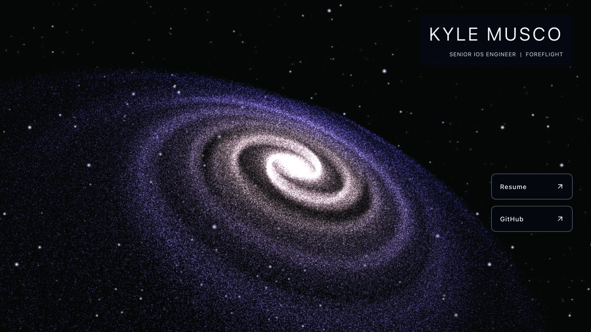
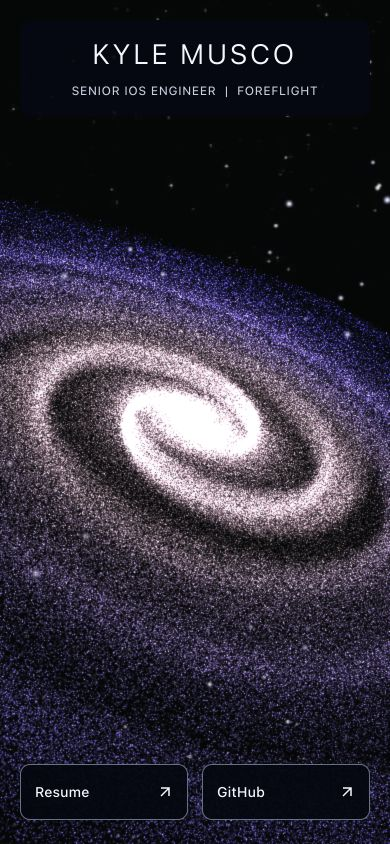

# Step 5 — Modern rendering pipeline

## Completed

- Replaced the temporary r77 adapter with modern Three.js and React Three Fiber.
  The homepage uses one transparent canvas, one R3F frame subscriber, and one
  draw call. The extra background sphere, lights, renderer, and loop are gone;
  the CSS starfield supplies the background and fallback.
- Attached the generator's XYZ `Float32Array` directly to BufferGeometry. The
  desktop configuration uses a 12,000,000-byte position buffer for one million
  stars, with no per-star vertex objects or unused interaction vectors. This
  is the position-buffer size, not a measurement of total browser/GPU memory.
- Moved GLSL out of HTML into a shader module, corrected matrix multiplication
  order, bounded point size and center glow, and integrated Three.js output
  color conversion. Retained the existing distribution and approximate palette;
  the more realistic structure, core, dust, and stellar variation remain step 6.
- Converted desktop rotation to radians per second, using the old 60 Hz speed
  as the reference. Clamp a stalled frame's delta to 100 ms to avoid large jumps.
  The old mobile rotation policy remains until the quality pass.
- Used R3F's container measurement to update drawing-buffer dimensions and
  camera aspect/projection on resize. Point sizing follows the physical buffer
  height. No CSS-only stretching or application-owned animation loop remains.
- Added a graphics error boundary, render/shader failure handling, context-loss
  pause, and automatic rendering recovery when the browser restores its context.
  The canvas stays hidden until a frame succeeds, exposing the static background
  during startup, context loss, or failure. The pre-rendered profile remains usable.
- Used R3F's declarative resource ownership and teardown for geometry, material,
  renderer, and WebGL context cleanup. Startup remains cancellable, and the
  client entry disposes graphics on Vite module replacement. StrictMode is
  enabled; generation happens once outside the graphics component render.
- Split graphics into a dynamically loaded module so the profile entry does
  not need to evaluate the graphics library before hydration. Removed the old
  runtime loader, r77 type definitions, adapter, and two-loop scheduling code.
- Added a development-only graphics fixture for repeatable inspection, loss /
  restoration, unmount/remount, shader failure, and unavailable-WebGL checks.
  It is excluded from production output. Added focused motion/recovery tests.

## Verification

- Node 24.21.0/npm 11.19.0: strict typecheck, typed lint, nine tests, formatting,
  production build, and all 66 preserved static asset comparisons passed.
- Unit tests verify equivalent rotation over ten seconds at 30/60/120 Hz,
  protection against stalled/invalid frame times, context-loss cancellation,
  restoration callbacks, shader-error propagation, and listener cleanup, along
  with the existing generation and camera checks.
- The development fixture confirmed one canvas, one graphics root, one geometry,
  one frame subscriber, one draw call, and one million positions. Resizing the
  same running page through 1280 × 720, 390 × 844, and 844 × 390 updated its
  buffer, shader height, and camera aspect correctly without regeneration.
- Using `WEBGL_lose_context`, actual context loss produced a hidden canvas and
  `frameloop: never`. Restoration returned it to visible/ready with one draw
  call and the original position count.
- Unmounting twice left zero canvases/roots, dispatched geometry and material
  disposal events, and released the old WebGL context. Remounting returned to
  exactly one canvas/root. Deliberately breaking the shader also released the
  graphics root and retained the profile/fallback.
- A separate fixture page that returned no WebGL contexts exercised the
  initialization error boundary: zero canvases/roots, with the profile and both
  links still present. Failure tests intentionally emit error logs.
- See [recorded graphics measurements](step-5-graphics-checks.json). Fixture-only
  inspection uses R3F's internal root registry; application code does not.
- The production preview rendered at desktop and phone-sized widths, including
  a live resize. No runtime/shader errors occurred on the normal page. One
  known dependency deprecation warning remains, described below. The profile
  retained 56px link targets and no horizontal overflow.
- Browser checks used the in-app Chromium browser on the local Mac. The narrow
  viewport retained a desktop user agent; physical iOS/Android and other desktop
  engines remain step 9. These checks do not replace hardware performance tests.

## Remaining and newly discovered items

- Step 6 is next: improve spiral structure, bulge/disk, stellar variation,
  dust/gas, bloom, and exposure. The current image is still the old distribution
  rendered through the new pipeline.
- Step 7 still owns adaptive particle counts/DPR, motion preferences, hidden-tab
  pause, and camera framing for device sizes. DPR is fixed at 1 for now. Retain
  the previous follow-up to profile synchronous generation before adding a worker.
- The graphics chunk is 915.76 kB minified / 243.38 kB gzip; the separate profile
  entry is 223.77 kB / 70.16 kB gzip. Vite reports its default large-chunk warning.
  Investigate the Three.js catalogue imported by R3F Canvas and transfer cost in
  the quality pass; do not hide the warning by raising its threshold.
- R3F 9.8.1 internally constructs `THREE.Clock`, deprecated by Three.js r186.
  The warning occurs in normal development and production rendering. It is a
  dependency compatibility follow-up, not an application animation failure.
  Track an upstream R3F update; no dependency patch or warning suppression was added.
- Modern WebGLRenderer requires WebGL2. Browsers/devices without it retain the
  static starfield and profile. Restoration depends on the browser restoring
  the lost context; a permanently unavailable context leaves the fallback.
- Later customization/camera/desktop repulsion UI is still outside this initial
  refactor. The camera and generation modules remain separate for that work.
- The original social-preview image still needs replacement after the galaxy's
  new appearance is settled. Preserve its existing URL as an archived asset.
- `2019` remains untouched. The `2022` archive, both résumés, and original public
  assets are unchanged. No publishing or remote push occurred. Stop for review.
