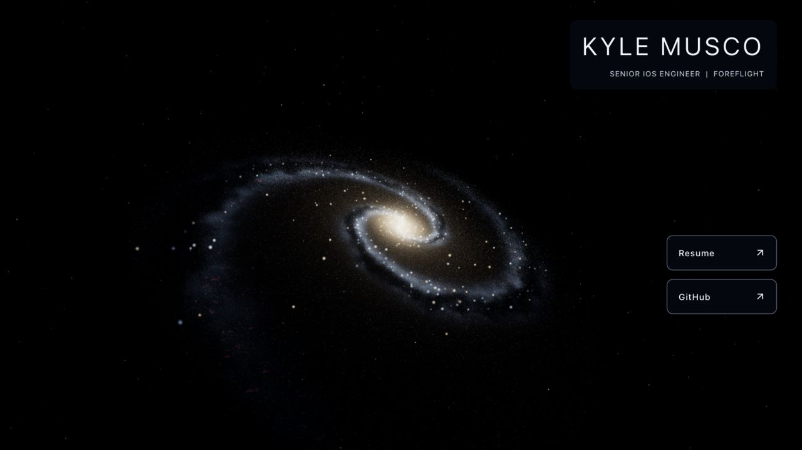

# Step 6 realism follow-up

Implement these tasks in order, committing and checking in with the owner after
each task. This follow-up remains part of step 6; general refactor steps 7–9 have
not started. Preserve the profile, résumé URLs, archives, and original assets.
Keep `2019` out of scope.

- [x] 1. Restore and lock the step 5 camera.
- [ ] 2. Define shared seeded morphology for stars, diffuse light, dust, and gas.
      Separate structural and appearance random streams; agree on interfaces
      before parallel work on distribution, stellar appearance, and medium rendering.
- [ ] 3. Improve stellar distribution with varied arm widths and strengths,
      asymmetry, clusters, subtle branches, and diffuse inter-arm stars.
- [ ] 4. Improve stellar populations, perspective-correct sprite sizing,
      subpixel coverage, and brightness consistency across particle counts.
- [ ] 5. Add depth to dust, gas, and central light using bounded thickness and
      camera-ray extinction. Keep all galaxy layers aligned during rotation.
- [ ] 6. Tune exposure, bloom, and background after structural integration.
      Preserve linear color processing and compare bloom enabled/disabled.
- [ ] 7. Verify animation, camera stability, lifecycle, responsive layouts, and
      startup/frame costs. Address mobile animation explicitly, capture fixed
      animation phases, and refresh the social preview after visual acceptance.

One integration owner should handle scene wiring. Tasks 3–5 can be delegated to
separate agents after task 2 establishes shared contracts and module ownership.

## Task 1 — Camera restored

Restored the exact camera settings from commit `02312a3`, which produced
[the step 5 reference](step-5-desktop.jpg): position `[-100, -100, 80]`, target
`[0, 0, 0]`, roll `-0.7`, vertical field of view `70`, near `0.5`, far `1500`.
The existing camera test now checks these values. The development fixture reports
camera position/orientation/projection and galaxy rotation for subsequent checks.

The desktop comparison restores the diagonal orientation and inclination. The
galaxy occupies less of the frame than step 5 because step 6 changed its geometry
and light distribution. The remaining morphology and lighting tasks should be
judged from this camera rather than compensating by moving the camera again.

### Verification

- Node 24: typecheck, lint, ten tests, formatting, production build, and all 66
  preserved asset hashes passed.
- Desktop Chromium at 1280 × 720: rendered successfully, no horizontal overflow,
  one canvas/root/frame subscriber, and no runtime or shader errors.
- Two development-fixture samples confirm an unchanged camera transform while
  galaxy rotation advances. See [recorded samples](step-6-camera-checks.json).
- The existing desktop rotation rate remains `-0.00012` radians per second.
  Mobile's existing user-agent rotation exclusion remains for task 7 to address.
- Known dependency `THREE.Clock` deprecation and graphics bundle size warnings
  remain. No new dependencies, renderer resources, or per-frame allocations
  were introduced by this camera change.

No push or deployment. Stop after task 1 for the owner's requested check-in.
