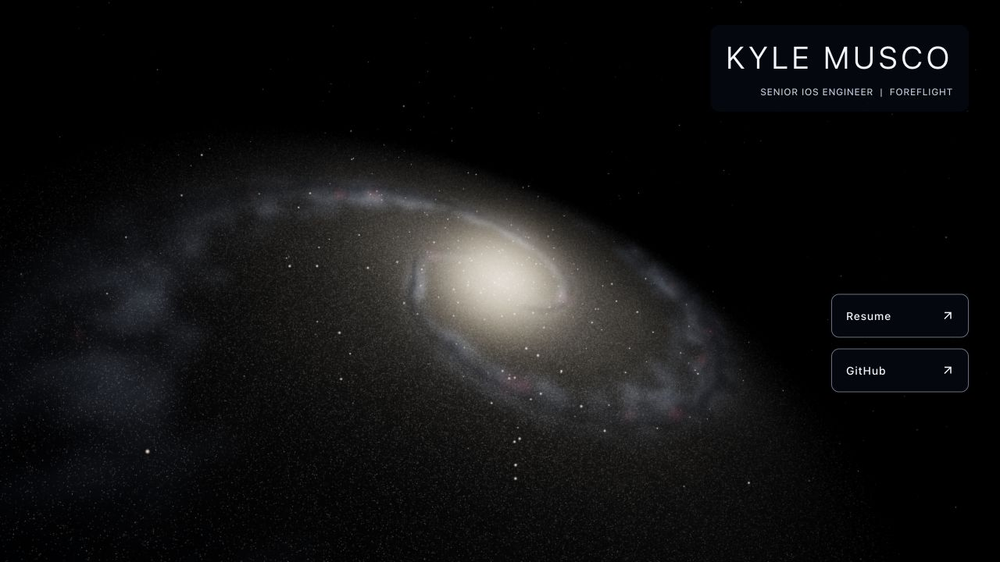

# Step 6 realism follow-up — complete

All seven tasks are complete. Per the owner's updated instruction, commits were
made during implementation and the next check-in is between main refactor steps.
General refactor steps 7–9 have not started. `2019` was not inspected or changed.

## Completed tasks

- [x] 1. Restore and lock the step 5 camera. Position `[-100, -100, 80]`, target
      `[0, 0, 0]`, roll `-0.7`, vertical FOV `70`, near `0.5`, far `1500` match
      commit `02312a3` and [the reference](step-5-desktop.jpg). Geometry now spans
      radius 145 with a bulge radius of 17; the camera itself stays fixed.
- [x] 2. Share one seeded morphology map between CPU generation and GPU rendering.
      Its four channels describe arms, dust, young associations, and disk
      modulation. CPU bilinear sampling matches the GPU texel convention.
      Separate random streams keep palette changes from moving the stars.
- [x] 3. Replace uniform spiral ribbons with varied widths and strengths, modest
      asymmetry, broken cloud structure, secondary branches, and a diffuse disk.
      Arm-biased rejection sampling uses the same map as the luminous medium.
      The thick central spheroid remains a separate three-dimensional population.
- [x] 4. Mix subdued warm/white disk populations with localized blue associations
      and sparse bright sources. Sprite size includes perspective focal length;
      filtered subpixel coverage avoids full-brightness one-pixel speckling.
      Count compensation applies to faint population light, leaving bright
      outliers restrained. Seeds and attribute prefixes remain deterministic.
- [x] 5. Replace the flat additive sheet with a bounded volume. Forty ray samples,
      concentrated through the thin disk, integrate emission and extinction.
      Six samples attenuate each star along its ray to the camera. The camera is
      transformed into galaxy-local coordinates each frame, so dust, gas, stars,
      and the rounded warm core stay aligned during rotation. This remains an
      illustrative approximation, not a full radiative-transfer simulation.
- [x] 6. Reduce core emission and pink knot intensity, strengthen structured dust,
      and use restrained bloom (strength 0.18, radius 0.45, threshold 0.95).
      Exposure remains 0.9 with ACES and the final OutputPass. The background
      remains subdued. Matched bloom-on/off captures show that the structure
      persists without bloom.
- [x] 7. Validate integration and motion. Desktop and mobile use the same slow
      angular velocity, `-0.006` radians/second. Reduced motion renders on demand
      without rotation; hidden tabs stop rendering. One R3F subscriber updates
      transforms/uniforms and renders; there is no per-frame star regeneration.
      Saved fixed-phase views, a live six-second recording, browser checks,
      startup/frame samples, and an updated production social-preview image.

## Visual evidence

The following desktop images use the same seed, viewport (1280 × 720), and phase
zero. Their geometry and color intentionally differ from the old step 5 render.

- [Bloom disabled](step-6-realism-no-bloom.jpg)
- [600,000-star comparison](step-6-realism-600k.jpg)
- [Rotation phase 0.35](step-6-realism-phase-035.jpg)
- [Portrait, 390 × 844](step-6-realism-mobile.jpg)
- [Landscape, 844 × 390](step-6-realism-landscape.jpg)
- [Live canvas animation, six seconds](step-6-realism-animation.webm)

The full-image mean RGB difference between 600k and 1m captures is less than
0.12/255 per channel; mean absolute pixel differences are about 1.83/255, primarily
from the changed particle sample. These are JPEG image comparisons, not a physical
energy measurement. The sparse bright stars can differ between quality levels.

## Verification and measured costs

- Node 24.21.0/npm 11.19.0: typecheck, typed lint, **14 focused tests**, formatting,
  production build, and all **66 preserved original asset checks** pass.
- Tests cover seeded maps and particle prefixes, finite/ranged attributes,
  shared-map sampling, aggregate stellar populations, invalid settings, camera
  pose/projection, frame-rate-independent rotation, motion policy, and context
  lifecycle handling.
- Chromium 153 on a MacBook Pro (MacBookPro18,1), Apple M1 Pro (10 CPU/16 GPU
  cores), 32 GB RAM. DPR 1. Samples are development-renderer main-thread frame
  intervals over 180 frames, not GPU timer queries or sustained device benchmarks.

| Viewport / count | Generation + mount | First ready frame | Median frame | p95 frame |
| ---------------- | -----------------: | ----------------: | -----------: | --------: |
| 1280 × 720 / 1m  |           512.5 ms |          661.0 ms |      12.0 ms |   17.2 ms |
| 390 × 844 / 600k |           334.0 ms |          460.4 ms |       8.3 ms |    9.3 ms |

The 600k startup was measured at desktop size before resizing for the portrait
frame sample. Startup starts after module import, includes synchronous generation
and React mount, and excludes network/module loading. These are single samples;
phone-sized Chromium on this Mac is not a physical-phone performance result.

- Resize checks retain one canvas/root/frame subscriber and no horizontal
  overflow. Buffers and point-size uniforms follow portrait/landscape dimensions.
- Real context loss hides graphics and pauses the loop; restoration returns to
  ready with one subscriber and the expected resources. Reduced-motion recovery
  remains on demand at rotation zero. The fixture simulates the media preference
  without changing the operating-system setting. Hidden-tab policy is unit-tested;
  its native visibility event integration still needs the broader browser matrix.
- Repeated unmount is safe and releases all renderer geometries and textures.
  Remount returns to one root. Deliberately invalid GLSL and unavailable WebGL
  both retain the static fallback and profile links. Those deliberate failures
  produce expected console errors; normal production rendering has no errors.
- [Raw browser checks](step-6-realism-checks.json). Only `desktop` and `portrait`
  contain independently measured frame samples; subsequent lifecycle records
  retained the fixture's last sample. The fixture now clears that field on remount.
- One million stars still use 32 MB of typed attributes; the shared map adds
  256 KiB. The renderer reports 17 draw calls, 4 geometries, and 14 textures
  including postprocessing. These counts exclude CPU/GPU driver overhead.
- Production graphics bundle is approximately 947 kB minified / 252 kB gzip.
  The existing bundle-size and dependency `THREE.Clock` warnings remain.
- Refreshed `/images/galaxy-preview.jpg` at 1200 × 630 from the production page.
  Original public assets, both résumés, the profile, and archive URLs are preserved.

## Remaining main steps and follow-ups

Main step 7 is next: adaptive device quality, bounded DPR, responsive framing,
and sustained physical-device profiling. Portrait currently crops the outer disk
with the locked camera; adjust framing without changing its inclination/roll.
Consider worker generation because roughly half a second of startup remains
synchronous at one million stars. Low-end/mobile GPU cost of the sampled medium
needs measurement before choosing lower-cost tiers. Sparse sprite shimmer and
extreme camera angles also deserve physical-device checks before camera controls.

Main step 8 prepares customization, camera controls, and desktop mouse repulsion;
main step 9 completes the browser/device matrix and hosting verification. None of
those interaction UIs has been added here. No deployment or remote push occurred.
