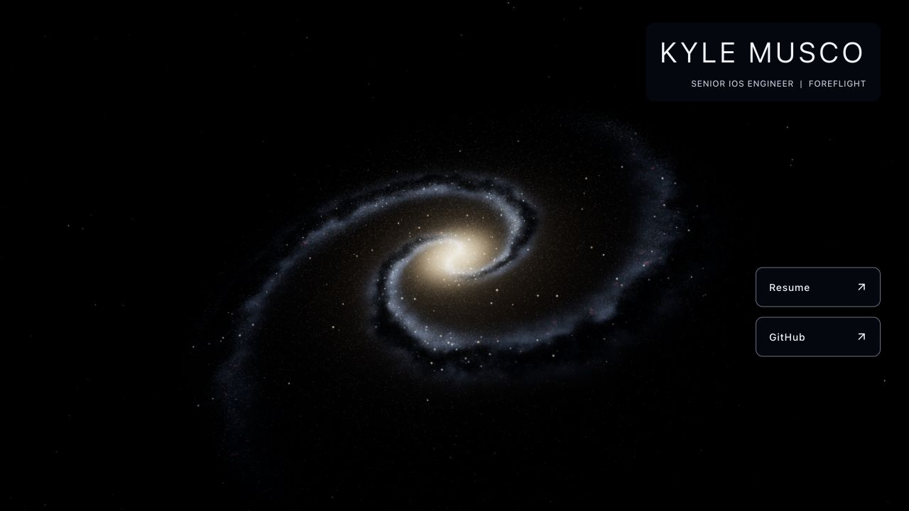
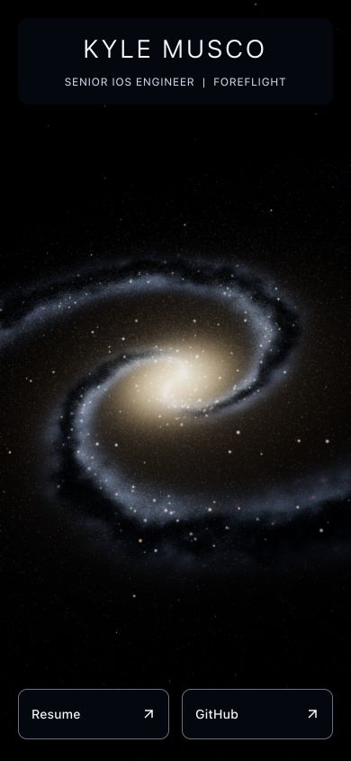

# Step 6 — More realistic galaxy

## Completed

- Replaced the flat ellipse distribution with a seeded three-dimensional model:
  a thick central spheroid, a thin exponential disk, two winding spiral arms,
  and diffuse stars between the arms. The arms have scatter and small deviations
  rather than forming identical, evenly spaced rings.
- Added per-star linear RGB color, world-space size, and luminosity attributes.
  The bulge emphasizes warm stars; the arms mix cooler stars with warmer ones.
  Bright stars are sparse and vary in size instead of every point looking alike.
  All attributes remain deterministic and retain their prefix when count changes.
- Added a diffuse disk shader with coherent dust lanes, mottled arm structure,
  soft central light, and sparse rose-colored gas-emission regions. Dust reduces
  stellar light as well as the diffuse disk, with stronger attenuation on the
  side away from the camera. The disk and stars rotate together in one group.
- Added 3,000 seeded background stars on a distant sphere within the same canvas.
  The active scene now has a dark opaque background; the original CSS starfield
  remains the fallback if graphics are loading, lost, or unavailable.
- Added HDR bloom with strength 0.24, radius 0.5, and threshold 0.85, followed by
  ACES filmic tone mapping and exposure 0.9. Point light profiles are bounded;
  the nucleus stays compact instead of clipping an entire central region white.
- Adjusted the default camera to show the disk's inclination and spiral depth.
  Camera pose remains separate from the generator. Device-specific artistic
  framing remains step 7; the portrait viewport currently crops the outer arms.
- Kept one canvas, one WebGL context, and one R3F frame subscriber. Postprocessing
  uses that scheduler, resizes with it, and survives context restoration. It adds
  render passes rather than another canvas or animation loop.
- Explicitly dispose the bloom targets/materials, output pass, and composer.
  Three r186's bloom cleanup omits its high-pass material; the application
  disposes that material separately without modifying dependency files.
- Refreshed the social-preview image at `/images/galaxy-preview.jpg` (1200 × 630)
  using the production-rendered page and updated Open Graph metadata. The old
  image and its URL remain unchanged, closing the step 3 preview-image follow-up.

## Visual reference and limits

The warm center, cooler arms, dark dust lanes, and small emission regions are
informed by [NASA's Hubble Whirlpool Galaxy reference](https://science.nasa.gov/asset/hubble/out-of-this-whirl-the-whirlpool-galaxy-m51-and-companion-galaxy/).
No NASA imagery is included in the renderer or downloaded into the project.

This is a procedural illustration, not a reconstruction of a particular galaxy,
an N-body simulation, or a radiative-transfer model. Individual stars have real
3D positions; diffuse gas and dust are approximated by a thin shader layer and
stellar attenuation. Their appearance at extreme camera angles remains an item
to assess when interactive camera controls are added.

## Verification

- Node 24.21.0/npm 11.19.0: typecheck, typed lint, ten focused tests, formatting,
  production build, and all 66 preserved asset hash comparisons passed.
- Tests cover finite/ranged positions and appearance attributes, invalid shape
  settings, stable seeds and count prefixes, a thicker/warmer bulge, a blue-rich
  disk, arm concentration with inter-arm stars, camera ordering, time-based
  motion, and context lifecycle handling.
- Development graphics checks verified one canvas/root/frame subscriber through
  desktop, portrait, and landscape sizes. The drawing buffer, camera aspect,
  and point-size uniform follow the viewport. There was no horizontal overflow.
- Real `WEBGL_lose_context` loss paused rendering and showed the fallback;
  restoration rebuilt the scene and bloom textures and resumed rendering.
- Unmounting twice left zero canvases/roots, released the WebGL context, and
  left the previous renderer reporting **zero geometries and zero textures**.
  Remounting returned to one root with the expected counts. Deliberately broken
  star GLSL triggered the static fallback and disposed the scene resources.
- See [recorded graphics checks](step-6-graphics-checks.json). The fixture now
  counts the complete multipass frame instead of only the final render call.
- Production screenshots were inspected at 1280 × 720 and 390 × 844; the narrow
  layout retains 56px link targets. Normal rendering had no shader/runtime errors.
  The known R3F `THREE.Clock` deprecation warning remains.
- These checks use desktop Chromium on the local Mac, including a desktop user
  agent at phone-sized viewports. Physical phones, other browser engines, HDR
  render-target capability coverage, and sustained performance remain later work.

## Remaining and newly discovered items

- Step 7 is next: adaptive quality, bounded DPR, reduced motion, hidden-tab pause,
  responsive camera framing, and performance tuning. Physical-device testing
  and the broader browser matrix still belong to step 9.
- At the current desktop count, stellar attributes total **32 MB** (12 MB of
  positions plus 20 MB of color/size/luminosity), excluding GPU copies, background
  data, and render targets. The complete frame uses **17 draw calls**, including
  bloom/output, and **13 render-target textures**. These are workload counts,
  not a measurement of total browser/GPU memory or frame rate.
- One local Node run generated one million stars in **246 ms**. It is a single
  CPU timing, not a browser or mobile benchmark. Together with the added shader
  and bloom cost, it reinforces profiling startup and considering worker-based
  generation and lower-cost quality tiers in step 7.
- The graphics chunk is approximately 940 kB minified / 249 kB gzip, and Vite's
  size warning remains. Investigate catalogue/transfer cost alongside quality
  tuning. The dependency-level Clock warning remains an upstream follow-up.
- Later customization and desktop pointer repulsion remain unimplemented. The
  separate settings, camera, typed rest positions, and grouped visual layers
  leave room for those features after the initial refactor.
- `2019` remains untouched. The `2022` archive, both résumés, and all original
  public assets are preserved. No deployment or remote push occurred. Stop here
  for the owner's review before starting step 7.
