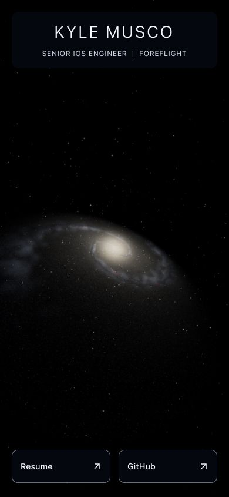

# Step 7 — Adaptive quality and responsive framing

## Completed

- Replaced user-agent-based particle counts with capability hints: coarse pointer,
  CPU cores, optional device memory, and data-saving preference choose an initial
  quality ceiling. Runtime measurements can step down within that ceiling.
- Added three explicit quality budgets. Render resolution obeys both the DPR
  ceiling and total pixel budget, with a 4096-pixel maximum drawing-buffer edge.

| Tier     | Generated/drawn stars | DPR ceiling | Pixel budget | Volume/star ray samples | Bloom |
| -------- | --------------------: | ----------: | -----------: | ----------------------- | ----- |
| High     |             1,000,000 |         1.5 |    2,000,000 | 40 / 6                  | Yes   |
| Balanced |               400,000 |        1.25 |    1,000,000 | 24 / 4                  | Yes   |
| Low      |               150,000 |         1.0 |      500,000 | 16 / 3                  | No    |

- Two consecutive three-second slow windows trigger a downgrade after a
  1.5-second warmup. Thresholds are 28 ms at high, 36 ms at balanced, and 85 ms
  at low. Three consecutive frames longer than 250 ms also trigger a step down.
  A persistently slow lowest tier yields to the static fallback. These initial
  thresholds are conservative policies, not device-performance guarantees.
- Quality only steps downward during a mount to avoid oscillation. Reducing the
  draw range retains the seeded star prefix and does not regenerate/upload new
  star buffers. The existing allocation remains until unmount. Fresh balanced
  and low mounts allocate 12.8 MB and 4.8 MB of stellar attributes respectively;
  high uses 32 MB. All tiers add the same 256 KiB shared morphology map.
- Moved seeded generation into a same-origin module worker. Typed buffers are
  transferred, not copied back. Success, failure, and cancellation terminate the
  worker. Late replies cannot mount a disposed scene. Worker denial leaves the
  static backdrop and profile usable, without synchronous main-thread generation.
- Added portrait zoom: `min(1, aspect / 1.65)`. Camera position, aim, roll, FOV
  setting, and desktop zoom remain unchanged. Narrow screens now show the whole
  central structure rather than a close crop of the core.
- Kept the desktop/mobile animation rate, reduced-motion demand rendering,
  hidden-tab pause, and context-loss behavior from step 6. Visibility, resize,
  preference changes, and context restoration reset performance sampling.
- Added an 8-bit render-target path without bloom for WebGL2 devices missing
  floating-point color-buffer support. Rendering can continue on these devices
  instead of attempting unsupported HDR targets.
- Updated the developer fixture and README. The fixture can select quality,
  cancel pending generation, inject bounded synthetic frame pressure, and test
  worker/HDR denial. No fixture controls or diagnostics are shipped in `dist/`.

## Visual checks

- [High desktop](step-7-desktop.jpg)
- [Balanced portrait at phase zero](step-7-mobile.jpg)
- [Low desktop](step-7-low-desktop.jpg)
- [Worker-denial fallback](step-7-fallback.jpg)

Lower tiers retain the overall structure with fewer points and coarser sampling.
The low tier is visibly grainier; its purpose is to keep slower devices usable.
The step 5 camera inclination and diagonal orientation remain intact.

## Verification

- Node 24.21.0/npm 11.19.0: typecheck, lint, **20 focused tests**, formatting,
  production build, and all **66 original asset checks** pass.
- Added tests for capability selection, high-DPR/large-screen pixel bounds,
  portrait framing, adaptation hysteresis, persistent long-frame handling,
  worker success/error, cancellation, and late replies.
- Production preview loaded the emitted module worker and rendered one ready
  canvas. Normal rendering had no runtime errors. R3F's existing `THREE.Clock`
  deprecation warning remains.
- Synthetic ten-second frame pressure changed high to balanced: drawn stars
  fell from 1m to 400k while the original 1m allocation remained. Both the star
  and volume shaders adopted the lower sample budgets. No scene remount was
  required. Unit tests additionally cover the full downgrade-to-fallback path.
- A 3840 × 2160 viewport used a 1885 × 1060 drawing buffer (approximately 2m
  pixels), with DPR 0.491 and desktop zoom 1. Portrait used zoom 0.280 and kept
  the profile and résumé/GitHub links accessible with no horizontal overflow.
- Immediate generation cancellation left zero roots/canvases. Worker denial
  reported failed generation and displayed the fallback. These checks exercise
  the asynchronous lifecycle rather than only the generator's return value.
- Actual `WEBGL_lose_context` loss and restoration retained the expected quality
  and one frame subscriber. Repeated unmount released all geometries/textures.
- Simulated missing HDR support rendered successfully with four draw calls and
  three textures. Reduced-motion simulation rendered at rotation zero with
  `frameloop: demand`. Existing no-WebGL/shader-failure handling is unchanged.
- Browser checks are recorded in [step-7-graphics-checks.json](step-7-graphics-checks.json).

### Local measurements and limits

Chromium on the local MacBook Pro (Apple M1 Pro, 10 CPU/16 GPU cores, 32 GB RAM).
The final samples use DPR 1 and 180 frame intervals in the development fixture.
They measure main-thread frame intervals, not GPU timer queries or sustained
physical-device performance. Worker startup timing starts after module import
and excludes loading the main graphics bundle.

| Sample              | Mount request | First ready frame | Median interval | p95 interval |
| ------------------- | ------------: | ----------------: | --------------: | -----------: |
| High, 1280 × 720    |        0.9 ms |          739.6 ms |         14.4 ms |      21.5 ms |
| Balanced, 390 × 844 |        0.3 ms |          385.5 ms |          8.3 ms |      11.2 ms |

Startup values belong to the same mounts, but the high mount began at portrait
size before resizing for the desktop frame sample. They are not viewport-specific
startup benchmarks.

Generation no longer occupies the main thread for roughly half a second. Total
first-frame latency still includes worker startup, generation, React mounting,
shader compilation, and drawing; it is not guaranteed to be faster than step 6.
Earlier high-DPR checks used approximately DPR 1.47, with an 18 ms median and
23.3 ms p95. These separate runs illustrate the rendering cost of extra pixels;
they are not controlled cross-device benchmarks.

No physical iOS/Android device was available through the connected browser.
Opening another in-app browser tab did not report the first document hidden,
so native tab-background behavior remains a browser-matrix check; the visibility
policy is unit-tested. Actual preference changes, long sessions, thermal pressure,
and other browser engines also need step 9 verification.

## Remaining and newly identified items

- Step 8 is next: interfaces/presets for customization and camera control, plus
  the disabled desktop mouse-repulsion extension. The interactive UI is later.
- Step 9 must profile real phones, verify native visibility changes and Safari/
  Firefox/Edge, and calibrate tier thresholds with sustained measurements.
- Downgrades reduce GPU work and target resolution but deliberately retain the
  original star allocation. A future memory-pressure policy could remount at a
  lower allocation if physical-device evidence warrants it.
- On HDR-capable devices the disabled low-tier bloom pass retains its allocated
  targets until unmount. It does no bloom draw calls; lazy allocation/disposal
  can be considered if measured memory pressure warrants the added lifecycle.
- The graphics chunk remains about 947 kB minified / 251 kB gzip; the new worker
  is about 4.6 kB minified. The bundle-size and dependency Clock warnings remain.
- Hosting must serve the generated worker JavaScript with the rest of `dist/`.
  If a CSP is configured, it must allow same-origin workers (`worker-src 'self'`).
- `2019`, original asset URLs, both résumés, the profile, and the separate archive
  are preserved. No remote push or deployment occurred. Stop for the owner's
  check-in before starting main step 8.
