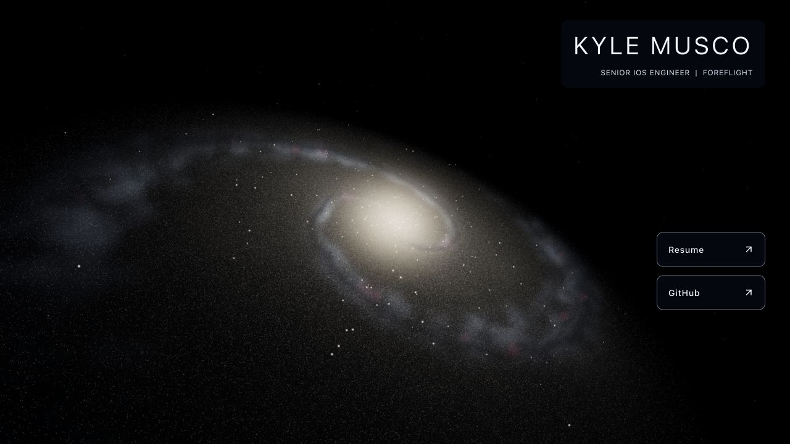
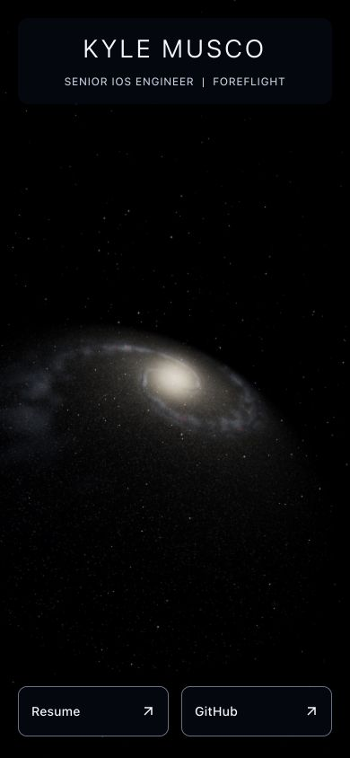

# Step 8 — controls and interaction extension points

Completed September 26, 2026. No deployment or remote push. The public landing
page retains the approved camera and animated galaxy; no customization panel or
repulsion simulation ships in this step.

## Completed

- Shared bounded validation and immutable settings/camera snapshots. Camera
  vectors are copied and frozen; invalid poses, projections and shape settings
  fail before workers or rendering changes.
- UI-independent controller with partial galaxy updates, three shape presets,
  independent camera changes, camera reset and full reset. Presets retain seed
  and star count. Full reset restores the mount's initial device budget and the
  approved camera while retaining animation phase and adaptive quality tier.
- Latest-request-wins worker generation. Superseded workers cancel; late replies
  cannot publish. The current scene stays visible while generating. Failed
  updates retain the current galaxy and can retry. Disposal cancels pending work.
- Controlled mount handle plus compatibility with the existing cleanup-only
  landing-page mount. Camera updates avoid generation; geometry replacement
  releases the previous buffers even when the star count is unchanged.
- Disabled-by-default `PointerRepulsionPort` contract. Future adapters receive
  normalized mouse coordinates and reset callbacks. Eligibility excludes touch,
  pen, coarse/non-hover input, reduced motion, hidden/lost graphics, dragging and
  links/form controls. No default pointer listeners or interaction arrays.
- Recovery on context loss, blur, pointer exit/cancel, capability changes, camera
  or galaxy replacement, disable, and unmount. The eventual simulation must
  implement restoration of rest positions in its reset callback.
- [API guide](../galaxy-controls.md), focused tests and development-only controls.

## Verification

`npm run check` passes type checking, linting, formatting and **27 tests**.
`npm run build` passes and verifies all **66 preserved assets** against baseline
checksums. Node 24.21.0 / npm 11.19.0. No dependencies added.

[Saved browser evidence](step-8-graphics-checks.json) was collected in the Codex
Chromium browser on the same Mac as step 7. The control suite passes ten checks
covering pose/projection without regeneration, bounded resolution, exact camera
reset, invalid-input rejection, cancellation races, presets, renderer/quality
retention, count changes, full reset and stable GPU resource counts.

| Case                                 | Result                                                                          |
| ------------------------------------ | ------------------------------------------------------------------------------- |
| Desktop, 1280×720                    | All control checks pass; approved camera quaternion restored; one canvas/loop   |
| Large desktop, 3840×2160             | All checks pass; buffer 1885×1060 at DPR 0.491, within two-million-pixel budget |
| Portrait, 390×844, balanced          | All checks pass; 400,000 stars; portrait zoom 0.28005 retained                  |
| Reduced motion                       | All checks pass; demand rendering and zero rotation through updates             |
| Context loss with test adapter       | Adapter reset, hidden canvas and stopped loop; restoration resumes graphics     |
| Unmount after repeated updates       | Zero canvases/roots; zero tracked GPU geometries/textures                       |
| Production preview, desktop/portrait | One ready canvas, no horizontal overflow, original profile links                |

The fixture warms one explicit frame before comparing GPU resources. React
StrictMode's startup cleanup can temporarily release a texture after the first
on-demand frame; comparing that initial count to a warmed renderer would report
a false leak. Repeated warmed updates remain at four geometries and 14 textures.

The pointer adapter fixture counts calls; it does not displace stars. Automated
port tests verify coordinate normalization, mouse/motion gating, recovery events,
and full listener removal. Physical mouse feel and interaction performance await
the actual simulation. A narrow desktop viewport is not a physical phone test.

The desktop capture is from the animated production preview. The portrait capture
below uses balanced quality after reset, frozen at phase zero solely for comparison.
Both preserve the step 5 camera pose; portrait retains step 7 responsive zoom.

## New findings addressed

- Control-triggered React renders could reset Canvas DPR to 1 independently of
  quality limits. Canvas now receives the current bounded DPR through state;
  camera and settings changes retain the resolution budget, verified at 4K.
- Regeneration must dispose the entire old geometry, not merely replace attribute
  objects. Geometry identity now follows the generation's morphology texture;
  stable resource counts and zero resources after unmount were verified.

## Remaining

Step 9: broader desktop browser checks, physical iOS/Android profiling,
production-hosting validation and final release readiness. The existing graphics
chunk-size and upstream `THREE.Clock` warnings remain. Real control UI, saved
settings and the desktop repulsion simulation remain in the later feature phase;
its adapter needs camera-aware projection, bounded forces and performance tests.
No new blocking issue remains for step 8.
