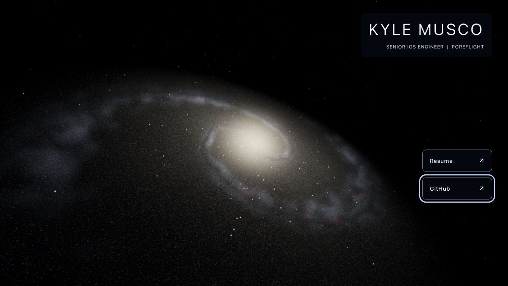

# Step 9 — local release validation and remaining sign-off

Local validation completed September 26, 2026 (saved JSON timestamps use UTC).
**Step 9 remains open** for the full browser/device matrix and real-host checks.
No deployment, server configuration change, remote push or dependency upgrade
was performed. The galaxy and approved camera defaults are unchanged.

## Accomplished

- Added `npm run verify:production`, also run by `npm run build`. It checks the
  pre-rendered profile and links, production module entry and worker, referenced
  files, absence of development/source directories, and preserved asset hashes.
- The optional origin argument checks actual HTTP responses, status, MIME types,
  file bytes and the archive directory URL. This makes the release check reusable
  on an explicitly selected staging origin serving the same build.
- Added a [release checklist](../release-checklist.md) covering reproducible builds,
  root hosting, MIME types, worker policy, compression, caching, archive retention,
  release ordering, rollback and concrete manual browser/device checks.
- Recorded desktop/narrow/portrait/landscape layout, keyboard focus, GPU recovery,
  cleanup, denial paths, reduced motion and non-HDR rendering evidence.
- Refreshed README architecture and verification instructions.

## Automated and HTTP results

Node 24.21.0 / npm 11.19.0. `npm run check` passes type checking, linting,
**27 focused tests** and formatting. `npm run build` passes both asset and
production validation. `npm ls --depth=0` reports a valid dependency tree.

[HTTP evidence](step-9-http-checks.json): 72 release files served correctly from
`http://127.0.0.1:4174`, plus the `/2022/` directory URL. All file bytes matched
`dist/`, including all **66 original assets**, both résumé PDFs and the emitted
module worker. Recognized MIME types matched their extensions. Source and fixture
files are absent from `dist/`. The excluded archive was neither inspected nor
changed. These are local preview results, not actual production-host validation.

| Generated file    | Raw bytes | gzip bytes |
| ----------------- | --------: | ---------: |
| Profile entry     |   223,815 |     69,440 |
| Graphics module   |   951,761 |    250,989 |
| Generation worker |     5,298 |      2,377 |
| Stylesheet        |     2,857 |      1,180 |

Sizes use Node gzip on the emitted files. Actual transfer size depends on the
host's encoding. The graphics chunk warning remains visible; it is already
loaded separately from the profile. The upstream `THREE.Clock` warning remains.

## Browser evidence

[Recorded browser checks](step-9-browser-checks.json) use the isolated Chromium
154 browser on the local Mac. Native Safari 27.0 rendered the production page,
verified visually and through its accessibility tree. Safari diagnostic testing
was interrupted by native-window targeting; no Safari lifecycle/performance pass
is claimed. Chrome 154 is installed, but its separate native profile was not tested.
Firefox/Edge and physical iOS/Android test surfaces were unavailable.

| Check                                             | Result                                                                                    |
| ------------------------------------------------- | ----------------------------------------------------------------------------------------- |
| Production at 320×568, 390×844, 844×390, 1280×720 | One ready canvas; no horizontal overflow; both links within the viewport                  |
| Link targets                                      | 56 px tall at every checked size; stack vertically at 320 px                              |
| Keyboard                                          | Forward/backward traversal reaches both links with a 3 px visible focus outline           |
| Accessibility structure                           | Named main/navigation/links; decorative canvas remains inside inert, aria-hidden backdrop |
| Production runtime errors                         | None captured in the isolated browser                                                     |
| WebGL context loss/restoration                    | Hidden/stopped on loss, ready/animated after restoration                                  |
| Unmount                                           | Zero canvas roots and zero tracked GPU geometries/textures                                |
| Worker denied                                     | Generation failed; no canvas; static backdrop/profile/links retained                      |
| WebGL denied                                      | Generation completed; no canvas; usable static fallback                                   |
| Reduced motion                                    | Ready, demand rendering, zero rotation                                                    |
| HDR unsupported                                   | Ready 8-bit path with four draw calls                                                     |
| No-JavaScript content                             | Confirmed in built HTML; browser-level JavaScript-off test still pending                  |

The desktop frame sample covered 180 intervals: median **26 ms**, p95 **40.5 ms**.
It began after a high-quality mount and ended at balanced quality, showing an
actual automatic step-down. This is **not** a fixed-tier benchmark or isolated GPU
measurement. Other native browser windows were present; startup was 3458 ms
under that load. No thresholds were tuned from this sample. Step 7 contains earlier
short samples; sustained physical-device measurements are still needed.

- [Production portrait](step-9-mobile.jpg)
- [Native Safari production render](step-9-safari.jpg)
- [Worker-denial fallback](step-9-fallback.jpg)

Portrait sizing in the isolated browser retains desktop input/capability hints;
its high tier does not stand in for physical phone capability selection. The
step 8 balanced-tier portrait checks remain available separately.

## Outstanding release checks

- Complete native Chrome/Safari/Firefox/Edge coverage, especially tab visibility,
  real preference changes, zoom/reflow, JavaScript disabled and PDF opening.
- Physical iOS Safari and Android Chrome: orientation/safe areas, toolbar resize,
  background/return, touch, low-power conditions and five-minute thermal sessions.
- Actual HTTPS host: compression/cache/MIME/CSP behavior, release procedure and
  rollback rehearsal. No deployment is authorized by these local checks.
- Customization and repulsion were subsequently implemented in the separate
  [interactive feature checkpoint](interactive-galaxy.md); the browser/device
  and actual-host sign-off above remains open.

No new application defect was found in these local checks. The remaining items
are verification gaps, not passing results. Keep the main checklist open until
those results are supplied or a narrower release scope is explicitly accepted.
